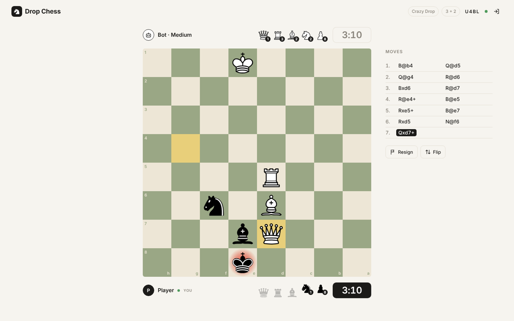
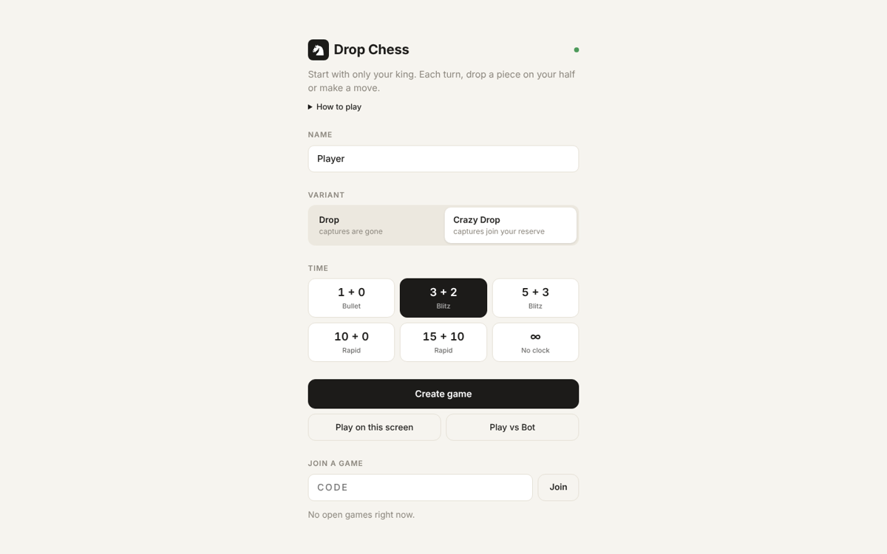
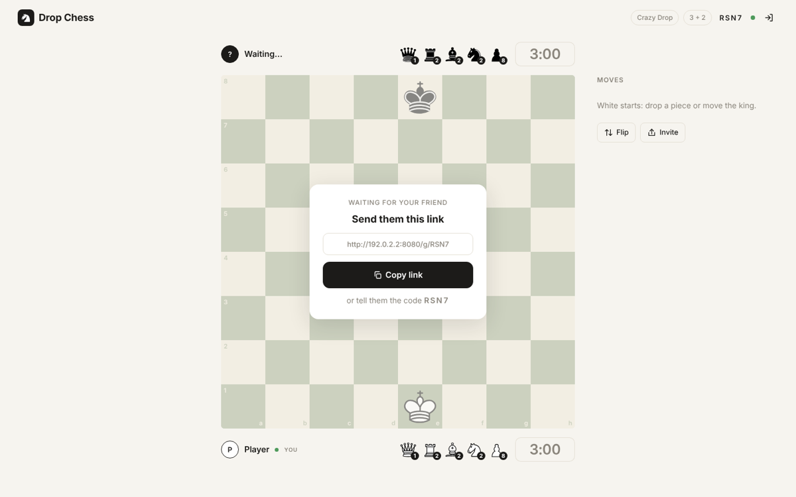
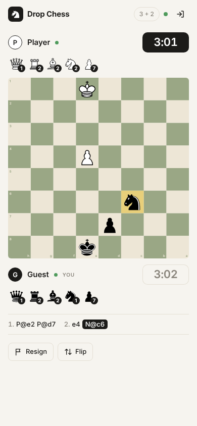
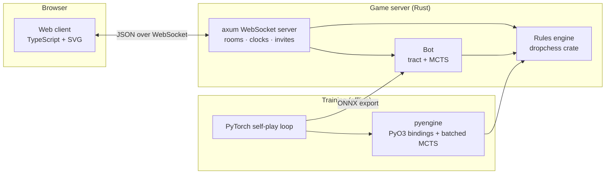

# Drop Chess

A chess variant where both armies start in reserve. Play it in the browser against a friend, on one screen, or against an AlphaZero-style bot trained from scratch by self-play.

**▶ Play now: [drop-chess.onrender.com](https://drop-chess.onrender.com/)** (hosted on Render's free plan, so the first visit after a quiet spell can take about a minute to wake up)



## Contents

- [The game](#the-game)
- [Features](#features)
- [Quick start](#quick-start)
- [Playing over the internet](#playing-over-the-internet)
- [The bot](#the-bot)
- [Architecture](#architecture)
- [Development](#development)
- [Roadmap](#roadmap)
- [License](#license)
- [Credits](#credits)

## The game

Each side starts with only its king on the board (White on e1, Black on e8). The other fifteen pieces (queen, two rooks, two bishops, two knights and eight pawns) wait in reserve.

On every turn a player does exactly one of the following:

1. **Drop** a piece from their reserve onto any empty square of their own half of the board: ranks 1–4 for White, ranks 5–8 for Black.
2. **Move** a piece already on the board, following the normal rules of chess.

Checkmate wins. Everything else follows standard chess, with these clarifications:

| Rule | Behaviour |
|---|---|
| Pawn drops | Not allowed on your own back rank. Doubled pawns are allowed. |
| Checks by drop | A drop may give check and may deliver checkmate. A drop may also block a check. |
| Pawn double step | A pawn on its second rank (dropped or not) may advance two squares. En passant applies. |
| Castling | Not available. |
| Promotion | Normal: queen, rook, bishop or knight. |
| Draws | Stalemate, threefold repetition, the 50-move rule (a drop resets the counter) and insufficient material once both reserves are empty. |

### Variants

| Variant | Captured pieces |
|---|---|
| **Drop** | Leave the game. |
| **Crazy Drop** | Change colour and join the capturer's reserve, as in Crazyhouse. A captured promoted piece returns as a pawn. |

## Features

- **Online play** with shareable invite links (`/g/K7QM`). The person who opens the link joins the game directly.
- **Same-screen play** for two players on one device.
- **A trained bot** in three strengths, for either colour and either variant.
- **Chess clocks**: 1+0, 3+2, 5+3, 10+0, 15+10, or untimed. The server keeps time, so clocks cannot be tampered with.
- **Server-authoritative rules**: every move is validated by the Rust engine. Clients receive the position and the list of legal moves.
- **Move history**: step through the game with the ‹ › buttons or the arrow keys (Home and End jump to the start and the live position), or click any move in the list.
- **Planning arrows**: right-drag between squares to draw an arrow, right-click a square to circle it. Hold Shift for red, Alt or Ctrl for blue. A left click or the next move clears them.
- **Move sounds** for moves, drops, captures, checks, game start and end, and a low-time warning. They are synthesised in the browser and can be muted from the top bar.
- **Drag and drop or click**: drag a piece (or a piece from your reserve) to its square, or click the piece and then the square.
- **Light and dark themes**: follows your device by default; the sun/moon button in the top bar switches between them.
- **Reconnects** automatically after a refresh or a dropped connection.
- **Responsive, minimal interface** that works on desktop and mobile.

| Lobby | Invite a friend | Mobile |
|---|---|---|
|  |  |  |

## Quick start

**Requirements:** [Rust](https://rustup.rs) (stable) and [Node.js](https://nodejs.org) 20 or newer.

```bash
git clone <repository-url> drop-chess
cd drop-chess

# Build the web client
cd web && npm install && npm run build && cd ..

# Run the server (serves the client, the game and the bot)
cargo run --release -p dropchess-server
```

Open <http://localhost:8080>. The server also prints an address for other devices on the same network.

| Environment variable | Default | Purpose |
|---|---|---|
| `PORT` | `8080` | Port to listen on. |
| `DROPCHESS_WEB` | `web/dist` | Directory of the built web client. |
| `DROPCHESS_MODEL` | `web/dist/models/dropchess.onnx` | Bot model. Without it, the server runs and the bot is unavailable. |

If devices on your network cannot connect, allow the port through the firewall, for example `sudo ufw allow 8080/tcp`.

## Playing over the internet

The server is a single process with no database, so any of the following works.

### Cloudflare Tunnel (from your own machine)

Free, no port forwarding, and the game runs on your computer. Install [`cloudflared`](https://developers.cloudflare.com/cloudflare-one/connections/connect-networks/downloads/), start the server, then:

```bash
# Temporary public URL, no account required
cloudflared tunnel --url http://localhost:8080
```

For a permanent address on a domain managed by Cloudflare:

```bash
cloudflared tunnel login
cloudflared tunnel create drop-chess
cloudflared tunnel route dns drop-chess chess.example.com
cloudflared tunnel run --url http://localhost:8080 drop-chess
```

### Render

The repository includes a [Render Blueprint](render.yaml). In the Render dashboard choose **New → Blueprint** and select the repository. The free plan sleeps after 15 minutes without connections and takes about a minute to wake on the next visit.

### Docker

```bash
docker build -t drop-chess .
docker run -p 8080:8080 drop-chess
```

The image builds the client and the server in separate stages and runs on `debian:bookworm-slim`.

> Games are held in memory. Restarting or redeploying the server ends games in progress.

## The bot

The bot is a small policy/value network combined with Monte Carlo tree search, in the style of AlphaZero. It learned the game entirely from self-play: no human games and no hand-written evaluation.

| | |
|---|---|
| Network | Residual CNN, 6 blocks × 64 channels, about 504k parameters |
| Input | 31 planes of 8×8: pieces, reserves, promoted pieces, repetitions, en passant, side to move, variant, move counter |
| Output | 4,992 move logits (4,672 board moves + 320 drops) and a value |
| Training | 185 generations, 11,842 self-play games, about 4.2 hours, one network for both variants |
| Search | PUCT (c = 2.0) with an exact mate-in-one check |

**Strength at generation 180** (30 games per match, half as each colour, 64 simulations per move):

| Opponent | Drop (W–D–L) | Crazy Drop (W–D–L) |
|---|---|---|
| Random mover | 30–0–0 | 30–0–0 |
| Greedy (mate in one, else best capture) | 26–3–1 | 29–0–1 |

**Levels in the game**

| Level | Behaviour |
|---|---|
| Easy | No search; samples a move from the network's policy. |
| Medium | 64 simulations per move. |
| Hard | 400 simulations per move, up to about 4 seconds. In timed games it uses at most 1/25 of its remaining time. |

At play time the bot runs inside the game server: [tract](https://github.com/sonos/tract) evaluates the ONNX model (about 1.3 ms per position on a laptop CPU) and the search mirrors the training implementation. Its state encoding is tested bit for bit against the training fixtures.

Training code, configuration and instructions are in [`train/README.md`](train/README.md). To ship a new model:

```bash
cd train && python export.py        # writes web/public/models/dropchess.onnx
cd ../web && npm run build          # copies the model into web/dist
# then restart the server
```

## Architecture



One Rust rules engine is shared by the server, the bot and the training pipeline, so the bot is trained on exactly the rules that people play.

### Repository layout

```
engine/     Rules engine: move generation, drops, check and mate, draws, FEN, UCI and SAN
server/     Game server: rooms, clocks, invite links, reconnects, the bot (bot.rs); serves the client
web/        Browser client: Vite + TypeScript, no framework
pyengine/   PyO3 module `dropchess`: rules, state encoding and batched MCTS for training
train/      Self-play training, evaluation and ONNX export (PyTorch)
design/     Interface mockups
docs/       Screenshots
```

### Protocol

The client and server exchange JSON messages over a WebSocket at `/ws`.

| Direction | Message | Purpose |
|---|---|---|
| Client → server | `create {variant, name, local?, color?, tc?, bot?}` | Start a game. `tc` is `{initialMs, incMs}`; `bot` is `easy`, `medium` or `hard`. |
| | `join {room, name}` · `rejoin {room, token}` | Take a seat, or reclaim one after reconnecting. |
| | `move {uci}` · `resign` · `rematch` · `leave` | In-game actions. |
| | `list` · `ping` | Open games; keep-alive. |
| Server → client | `joined {room, token, color, bot}` | Seat assignment. |
| | `state {...}` | Full game state: board, reserves, legal moves, status, move list (SAN and UCI), the FEN after every move, clocks. |
| | `rooms` · `error {msg}` · `pong` | Lobby list, errors, keep-alive. |

Moves use UCI notation, with drops written as `N@f3`, `P@d4`. Positions use Crazyhouse-style FEN with the reserve in brackets:

```
4k3/8/8/8/8/8/8/4K3[QRRBBNNPPPPPPPPqrrbbnnpppppppp] w - - 0 1
```

## Development

```bash
# Terminal 1: server (debug build)
cargo run -p dropchess-server

# Terminal 2: client with hot reload on http://localhost:5173 (proxies /ws to :8080)
cd web && npm run dev
```

### Tests

```bash
cargo test -p dropchess          # rules, perft counts shared with the Python reference engine
cargo test -p dropchess-server   # bot encoding vs training fixtures, mate-in-one
cd train && pytest -q            # rules, Rust vs Python cross-check, MCTS, replay buffer
```

`train/fixtures/` holds the shared test data: perft counts and 611 positions with their legal moves, action indices and a hash of the encoded planes. The Rust engine, the training code and the server bot are all checked against it.

## Roadmap

- Offline bot in the browser (engine compiled to WebAssembly, network on onnxruntime-web), allowing a static build for itch.io.
- An original piece set.
- A longer training run with the larger 8 × 96 network configuration.

## License

Drop Chess is released under the [PolyForm Noncommercial License 1.0.0](LICENSE.md). You may use, study, modify and share it for any noncommercial purpose, including personal projects, education and research. Commercial use, including selling the software or offering it as a paid service, requires written permission from the author.

Third-party assets keep their own licenses: the chess pieces are BSD 3-Clause and the Inter typeface is under the SIL Open Font License (see Credits).

## Credits

- Chess pieces: the "cburnett" set by Colin M.L. Burnett, used under the BSD 3-Clause license (see [`web/src/pieces/LICENSE`](web/src/pieces/LICENSE)).
- Typeface: [Inter](https://rsms.me/inter/) by Rasmus Andersson (SIL Open Font License), bundled through `@fontsource/inter`.
- Neural network inference: [tract](https://github.com/sonos/tract).
- GitHub icon: the GitHub mark from [Octicons](https://github.com/primer/octicons) (MIT), used to link to this repository.
- Reference rules implementation for testing: [python-chess](https://python-chess.readthedocs.io).
- Method: Silver et al., *A general reinforcement learning algorithm that masters chess, shogi, and Go through self-play*, Science, 2018.
